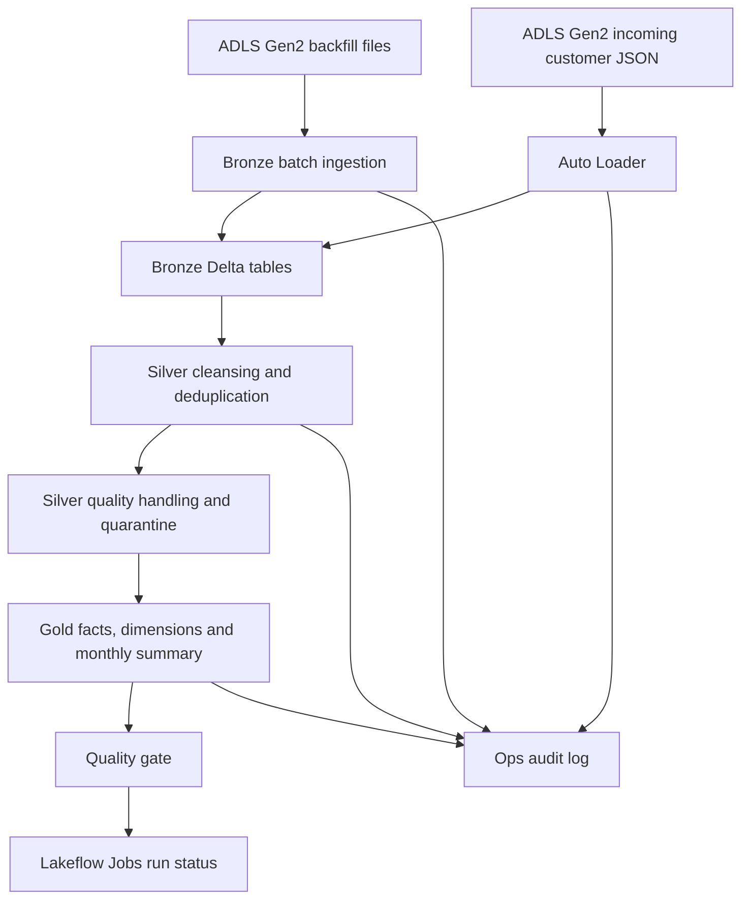

# GizmoBox: Azure Databricks Lakehouse

A portfolio-grade data engineering project built around **Azure Databricks, ADLS Gen2, Delta Lake, Unity Catalog, Auto Loader, PySpark and Lakeflow Jobs**. It demonstrates multi-format ingestion, a Bronze/Silver/Gold architecture, idempotent Delta writes, malformed-record handling, data-quality gates, audit logging and reproducible deployment configuration.

> **Execution status:** this repository has been statically validated and its dependency-free unit tests run locally. The full pipeline requires an Azure Databricks workspace, a Unity Catalog-enabled catalog and an ADLS Gen2 location. No live Azure job run is claimed by this repository bundle.

## Architecture



### Layers and objects

| Layer | Main tables | Responsibility |
|---|---|---|
| Bronze | `customers_raw`, `orders_raw`, `payments_raw`, `addresses_raw`, `refunds_raw`, `membership_files` | Preserve source payloads, source-file lineage, ingestion timestamps and record hashes. Malformed JSON is retained in `_corrupt_record`. |
| Silver | `customers`, `orders`, `order_items`, `payments`, `addresses`, `refunds`, `memberships` | Explicit typing, standardisation, deterministic key-based deduplication and rejected-record tables. |
| Gold | `dim_customer`, `fact_orders`, `fact_payments`, `fact_refunds`, `monthly_order_summary` | Business-friendly models with explicit grains and pre-aggregated child tables to avoid join fan-out. |
| Ops | `pipeline_audit`, `quality_results` | Append-only stage audit events and quality check results. |

The Gold customer dimension intentionally excludes direct contact fields. Contact details remain in Silver and should be governed with Unity Catalog permissions appropriate to the environment.

## Source data

The `data/sample/` directory contains a small synthetic fixture created for this repository. It follows the formats and patterns covered by the supplied course materials, but does not redistribute the course PDFs, DBC archives or course-provided datasets.

- Historical batch files: `data/sample/gizmobox/`
- New customer file for Auto Loader: `data/sample/incoming/customers/`
- The order sample contains one intentionally malformed JSON line to exercise quarantine handling.
- Membership PNGs are minimal synthetic placeholders. The pipeline uses the filename (`customer_id`) and month folder only; it does **not** perform OCR or claim to extract image content.
- Refunds are supplied as a CSV extract for repeatable runs. `sql/azure_sql_refunds.sql` is an optional corrected Azure SQL seed script; the default job does not connect to a live Azure SQL database.

## Requirements

- Azure Databricks workspace with Unity Catalog enabled.
- An existing catalog that your user can use, create schemas in and create managed Delta tables in.
- ADLS Gen2 storage accessible to the workspace through a Unity Catalog storage credential/external location or an approved workspace identity configuration.
- Permission to read/write the configured landing and checkpoint paths.
- Databricks CLI with Asset Bundles support for deployment (`databricks bundle`).
- A supported Azure VM type in the workspace region. The default is `Standard_DS3_v2`; override it if unavailable.

Do not place storage account keys, access tokens or passwords in the repository. Use Unity Catalog storage credentials/managed identities and workspace secret management.

## ADLS layout

Choose one ADLS path as the project root, for example:

```text
abfss://<container>@<storage-account>.dfs.core.windows.net/landing
├── backfill/gizmobox/
│   ├── customers/*.json
│   ├── orders/*.json
│   ├── payments/*.csv
│   ├── addresses/*.tsv
│   ├── refunds/*.csv
│   └── memberships/YYYY-MM/*.png
├── incoming/customers/*.json
└── _checkpoints/
```

Upload the contents of `data/sample/gizmobox/` to `backfill/gizmobox/` and `data/sample/incoming/customers/` to `incoming/customers/`. The `landing_root` bundle variable must point to the common `.../landing` root, **not** to `backfill/gizmobox`.

Use a separate durable checkpoint root, for example:

```text
abfss://<container>@<storage-account>.dfs.core.windows.net/checkpoints/gizmobox
```

The checkpoint root must not be inside a directory that gets overwritten during a backfill. Keep it stable between job runs. The sample `.keep` file under `incoming/customers` is ignored by Auto Loader's `*.json` file filter.

## Configure and deploy

1. Create or select a Unity Catalog catalog and confirm you can create schemas and managed tables.
2. Configure ADLS access using your organisation's approved Unity Catalog storage credential and external location. Test read/write permissions before running the job.
3. Upload the sample data using the layout above.
4. Install and authenticate the Databricks CLI for your workspace. Check `databricks --version` and `databricks auth describe`.
5. From the repository root, validate the bundle with your real paths:

```bash
databricks bundle validate -t dev --var="catalog=gizmobox,landing_root=abfss://<container>@<account>.dfs.core.windows.net/landing,checkpoint_root=abfss://<container>@<account>.dfs.core.windows.net/checkpoints/gizmobox"
```

6. Deploy the bundle:

```bash
databricks bundle deploy -t dev --var="catalog=gizmobox,landing_root=abfss://<container>@<account>.dfs.core.windows.net/landing,checkpoint_root=abfss://<container>@<account>.dfs.core.windows.net/checkpoints/gizmobox"
```

7. Run the deployed job from the Databricks Workflows UI or CLI. Review each task's output, `ops.pipeline_audit`, `ops.quality_results`, and the final Gold tables.

> Databricks CLI option syntax can vary by CLI version. If your installed CLI does not accept the comma-separated `--var` value, use its `databricks bundle deploy --help` syntax for passing bundle variables or set them in the target configuration. Do not commit environment-specific storage paths if they reveal internal infrastructure.

### Manual workspace validation

If you prefer to run notebooks before deploying the bundle, import/sync the repository into your workspace and run these notebooks in order:

1. `notebooks/01_bronze_batch.py`
2. `notebooks/02_bronze_autoloader_customers.py`
3. `notebooks/03_silver_transform.py`
4. `notebooks/04_gold_models.py`
5. `notebooks/05_data_quality.py`

Supply `catalog`, `landing_root` and `checkpoint_root` widget values. The bootstrap notebook creates the `bronze`, `silver`, `gold` and `ops` schemas if the selected catalog permissions allow it.

## Incremental and idempotency design

- Historical Bronze ingestion merges on `(source_file, record_hash)` so rerunning unchanged immutable files does not duplicate source records.
- Silver tables upsert on their declared business keys (`customer_id`, `order_id`, `payment_id`, etc.). Customer rows are deduplicated by latest `created_timestamp`, with `_record_hash` as a deterministic tie-breaker.
- Auto Loader reads only JSON files from `incoming/customers`, stores schema/checkpoint state under the configured ADLS checkpoint root and uses `availableNow` so the task finishes after processing currently available files.
- The historical and incoming locations are deliberately separate. Do not copy the same file to both locations unless you explicitly intend to test duplicate-arrival handling.
- Audit history is append-only. Business tables are idempotent, but an audit event is expected for every stage execution.
- The pipeline is not described as end-to-end exactly-once. Checkpoint state, Delta commits, task retries and operational audit records have separate failure boundaries and should be tested in the target workspace.

## Business definitions and limitations

- `fact_orders` has one row per `order_id`. Payment and refund details are aggregated to order grain before joining to avoid multiplication of order amounts.
- `fact_payments` has one row per payment; the supplied source contains status codes but no payment amount. Status codes are retained as codes rather than assigned unverified business labels.
- `fact_refunds` has one row per refund.
- `net_order_amount` is defined as completed-order amount less refunds associated with those completed orders; non-completed orders contribute zero. The monthly `refund_amount` metric reports refunds across all linked orders separately. Validate these definitions with a business owner before treating them as financial reporting metrics.
- Orphan payment/order and refund/payment relationships are recorded as warnings rather than automatic failures because real source extracts can be incomplete. Investigate warnings before production use.
- Customer files may contain multiple versions of a customer. The current Silver model keeps the latest valid record; SCD Type 2 is not enabled because the source contract has not been established as a reliable historical change feed.
- Membership data is represented only by customer ID and month inferred from the path. No membership tier is inferred from the image bytes.

## Testing and local validation

The local checks do not require Spark or Azure:

```bash
python scripts/validate_repo.py
python scripts/simulate_pipeline.py
python -m unittest discover -s tests -v
```

Install `requirements-dev.txt` if you want YAML parsing and pytest available locally. The local test suite covers dependency-free contract helpers, source-path composition and malformed JSON handling. It does **not** execute PySpark/Delta code. Cloud acceptance tests should be run in Databricks after deployment.

## Suggested cloud acceptance run

1. Run the full job once; verify the single malformed order is present in `silver.orders_rejected` and not in `silver.orders`.
2. Run it again with no new files; confirm business-table counts and key metrics are unchanged.
3. Add a new customer JSON file to `incoming/customers`; rerun the job and verify the customer appears once in Bronze, Silver and Gold.
4. Add a malformed customer JSON file; confirm it is handled according to the configured corrupt/rescued data columns and review schema evolution behaviour.
5. Stop a task after Bronze succeeds and rerun; confirm the merge keys prevent duplicate business records.
6. Inspect `ops.pipeline_audit` and `ops.quality_results` for run evidence.
7. Capture genuine Databricks job/task screenshots and query outputs for the GitHub README; do not use mock screenshots as runtime evidence.

## Repository layout

```text
GizmoBox-Azure-Databricks-Lakehouse/
├── databricks.yml
├── resources/gizmobox_pipeline.yml
├── notebooks/                 # Thin Databricks task entry points
├── src/gizmobox/              # Reusable pipeline logic and explicit schemas
├── sql/                       # Optional Azure SQL source seed
├── data/sample/               # Small synthetic fixtures
├── tests/                     # Dependency-free unit tests
├── scripts/validate_repo.py   # Static validation
└── docs/                      # Architecture, data dictionary and runbook
```

## Next improvements

- Add SCD Type 2 only after establishing source update/delete semantics.
- Add an Azure SQL JDBC ingestion task if a real Azure SQL instance is provisioned.
- Add Git-based CI/CD with bundle validation and unit tests.
- Compare measured query runtimes before and after an appropriate Delta optimisation; don't claim performance gains without recorded evidence.
